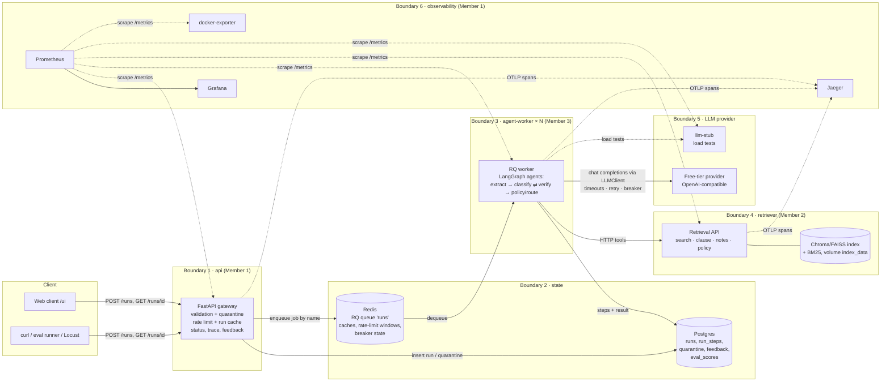

# Architecture and deployment boundaries (D3)

A run: the client `POST /runs` → the API validates the request (a rejection is quarantined and **no run is created**) → a run row is written and a job is enqueued → any free worker takes it → the agents call retriever tools and the LLM, writing one `run_steps` row per step → the result is saved → the client polls `GET /runs/{id}` (or gets a callback).

## Why each boundary is where it is

The spec asks us to justify boundaries on **scaling, failure isolation, independent release, resource profile**.

| Service | Scaling | Failure isolation | Independent release | Resource profile |
|---|---|---|---|---|
| **api** | One replica serves many clients; its work is milliseconds. | If workers or the LLM are down, the API still accepts, validates, quarantines and reports status. Clients get honest `queued`/`failed` answers, not hangs. | The contract (OpenAPI, `shared/contracts`) changes rarely. UI/validation fixes ship without touching agents. | Light: CPU-cheap, small memory. |
| **agent-worker** | **The unit we scale** (`--scale agent-worker=N`). Runs take tens of seconds and are I/O-bound on the LLM. | A crash kills one job, not the service. The watchdog marks that run `failed`, and the circuit breaker contains provider outages. | Prompt and agent changes ship here alone. The prompt version is recorded per run. | Moderate CPU, holds no index. |
| **retriever** | Usually one replica; can scale separately if retrieval becomes the bottleneck. | An index rebuild or crash does not take down the API. Workers degrade to escalation. | **Re-indexing / re-embedding without redeploying agents** (L1, D2). | **Heavy**: holds the embedding model and index in memory. Keeping it apart stops the workers from each loading the model. |
| **postgres / redis** | Shared state lets workers be stateless, which is what makes scaling possible. | Durable run history survives worker restarts. Redis holds only queue/cache, which can be rebuilt. | Off-the-shelf images. | Standard. |
| **llm-stub** | Lets load tests measure our system instead of provider rate limits (D6). | Swapped in by configuration only (`LLM_BASE_URL`). | Independent. | Tiny. |
| **prometheus / grafana / jaeger / docker-exporter** | Not on the request path. | Monitoring failing never fails a run. | Dashboards are provisioned from files. | Small. |

## Rejected alternatives

- **One process doing API + agents.** Simpler, but a slow LLM call would block the API, scaling would mean scaling everything, and the embedding model would load in every replica.
- **Celery instead of RQ.** More features (routing, beat), but more configuration. RQ is enough for one queue with job timeouts and lets the API enqueue by function name without importing agent code.
- **Kafka/RabbitMQ.** Not needed at this scale. Redis already serves caches and rate limiting.
- **cAdvisor for container metrics.** It cannot see containers on Docker Desktop for Mac (incident 2), so we use a small Docker-socket exporter.
