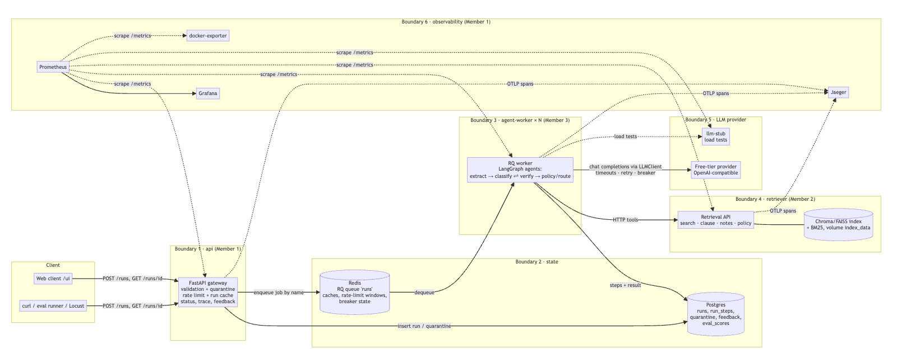

# Export Classification Check Service: Report

**Mini Project 07 · UE24AM342AA5 ML System Design and AgentOps · PES University**

| Member | Area |
|---|---|
| Sai Nikitha Perumalla (PES2UG24AM142), Member 1 | Platform, API and ops |
| Member 2 (satwik-0110) | Corpus, retrieval and evaluation |
| Member 3 (Sanshray10) | Agents and LLM |

Repository: `export-classification-check` (the README has run instructions). Status as of 2026-11-16.

> All results below are measured. Real-model results are from Groq's free tier (2026-11-15/16), which allows 8k tokens/minute and 200k tokens/day per model. That limited how many real runs we could make, and §5 says how.

---

## 1. Problem and scope

An exporter must classify each product under an **HS code**. The code sets the duty, whether a licence is needed, and the documents required, and a wrong code can hold a shipment at customs. Classification is not a lookup. The **General Rules for Interpretation (GRI)** apply in strict order, and section and chapter **notes override** the plain wording of headings.

We built a **multi-agent service** that takes a product description, validates it, proposes a classification with the rule and passages it relied on, states the **DGFT export policy**, and routes the case to `clear-for-filing`, `seek-product-clarification` or `specialist-classification-review`. **It never files a declaration**, and it escalates instead of guessing.

**Scope:** the CBIC Customs Tariff GRI, Section XV notes, Chapters 73 and 96, and the DGFT export policy for those chapters (8 official PDFs, `corpus/SOURCES.md`). Out of scope: duty calculation, shipping documents, other chapters (these are escalated).

**The hard case (§4.1):** *"Stainless steel vacuum flask with a moulded plastic outer body."* A material-first search lands in Chapter 73 (steel). GRI 1 requires the heading that **names** the article: **9617** "Vacuum flasks …". **Section XV Note 1(m)** excludes "other articles of Chapter 96" from the base-metal chapters. Our reference answer (`docs/decisions.md` D1): heading **9617** by **GRI-1**, citing GRI-1, HDG-9617 and SEC-XV-NOTE-1, routed **seek-product-clarification**, because 9617 00 11 (≤ 0.75 l) and 9617 00 12 (> 0.75 l) differ only by capacity, which the sentence does not give. With "Capacity 500 ml." the answer is **96170011**, `clear-for-filing`, policy Free.

## 2. Agent design (A1–A5)

**Topology (LangGraph):** `input_guard → intake → classifier ⇄ verifier → policy_route`, with a `degrade` path from any node. Each agent has its own prompt, its own tool permissions, a typed input and output, and its own failure handling. The hand-off is a typed state object (`state.py`).

| Agent | Responsibility | Tools allowed |
|---|---|---|
| input_guard | injection scan on every free-text field; toxicity check | none |
| intake (extractor) | identify the article, function and materials (F3) | `get_request_fields` |
| classifier | tool-using loop: the model **chooses** what to retrieve (F4, F5) | `search_corpus`, `get_clause`, `get_applicable_notes`, `get_request_fields` |
| verifier | checks the draft **before** anything is returned (A3) | `get_clause` |
| policy_route | export policy and route, decided in code (F6, F7) | `get_export_policy` |

**The §5 loop, step by step:**
1. The classifier retrieves what appears to apply.
2. **A provision that modifies it is looked up in code:** for a Chapter 96 heading on an iron or steel article, the Chapter 73 candidate's applicable notes are fetched and the excluding item is cited (Section XV Note 1(m)).
3. The classifier searches again with queries from what it has read (keyword search for the article's name).
4. **The verifier** checks deterministically that every quote is exact text of a passage retrieved *in this run* (titles allowed, and exact fragments joined by "…"), that the heading and the deciding rule are cited, that the tariff line exists under that heading, and that the GRI order was followed. Then an LLM checks that the cited text supports each claim.
5. On failure, the classifier retries with a **different strategy** (keyword by function, then dense across both chapters), carrying the passages already found, up to 2 retries. After that, **escalation**.

**Loop bounds:** `AGENT_MAX_STEPS=20`, `AGENT_MAX_TOOL_CALLS=16`, `CLASSIFIER_MAX_TURNS=10`, `AGENT_MAX_WALL_S=420` (raised from 240 after the Groq evaluation, see §5). Hitting any of them escalates, never answers.

**If an agent fails mid-run (A2):** every node runs inside a wrapper that turns any error into a controlled stop. Every step is written to `run_steps` as soon as it finishes, so **all steps before the failure are kept**, and `GET /runs/{id}/trace` shows them. Nothing that stops early can return a confident answer:

| Failure | Final status | Route |
|---|---|---|
| Prompt injection detected (guard) | escalated | specialist, no model called |
| AI provider down / breaker open (any agent) | degraded | specialist, no code, candidate headings listed |
| Loop bound hit (steps, tool calls, time) | escalated | specialist |
| Verification fails 3 times | escalated | specialist, no unverified citations |
| Unexpected error inside an agent | failed | specialist |
| Worker process killed | failed (set by the API watchdog) | none |
| Retriever down | usually escalated (nothing verifiable) | specialist |

All cases are tested (`docs/agent_design.md` §4).

**Reliability (A5):** every LLM call has a timeout and bounded retry with exponential backoff and jitter. There is a **circuit breaker per provider, with its state in Redis** so every worker replica shares it. The fallback path is primary model → fallback model → **degraded retrieval-only result** (candidate headings, no code, specialist route). HTTP 429 is treated as a rate limit, not an outage: the client waits for the provider's `Retry-After` (incident 9). A chaos switch (`redis-cli SET ecs:chaos:llm_fail all`) demonstrates the breaker. **The A.5 invariant**, `clear-for-filing` only when verified and completed, is enforced in the contract model, the router and the result builder.

**Guardrails (L4):**
- Injection: a heuristic scan of every free-text field, plus delimiters around customer data. A hit escalates the run, and no model ever sees the text.
- Toxicity: `detoxify` runs on input and output.
- Output filter: removes claims of filing, finality or duty amounts, and always adds the disclaimer. Tools are read-only.

**Prompts as versioned artifacts (L2):** `prompts/<agent>/v<n>.yaml` holds the text, schema and changelog. `classifier@v1` (free reasoning) and `classifier@v2` (explicit GRI checklist). The version is recorded on every step and every result.

## 3. Architecture and deployment boundaries (D3)

Ten services start with one `docker compose up` from a clean clone (CI checks this on every PR): `api`, `agent-worker` (× N), `retriever`, `llm-stub`, `postgres`, `redis`, `prometheus`, `grafana`, `jaeger`, `docker-exporter`.

| Boundary | Why it is separate |
|---|---|
| **api** | Failure isolation: it keeps validating, quarantining and answering status even when workers or the LLM are down. Light resource profile. |
| **agent-worker × N** | **The unit that scales** (`--scale agent-worker=3`). Runs take tens of seconds and are LLM-bound. Agents and prompts ship independently. |
| **retriever** | Heavy resource profile (embedding model + index in memory, loaded once, not per worker). **Re-indexing without redeploying agents.** |
| **postgres / redis** | Shared state makes workers stateless, which is what makes scaling possible. |
| **llm-stub** | Lets load tests measure our system rather than the provider (D6). Swapped in by configuration only. |
| **observability** | Off the request path: monitoring failing never fails a run. |

**Async execution (A4):** `POST /runs` validates, creates the run and enqueues an RQ job by name, then returns **202 with a run ID**. Clients **poll** `GET /runs/{id}`; a callback URL is optional. We chose polling because it works for every client (including those behind NAT), is idempotent, and survives client crashes. **Validation (D1):** one shared Pydantic contract covers schema, ranges, categories and cross-field rules (material shares sum to 100 ± 1, quantity ⇔ unit, declared code in chapters 73/96). Rejects are quarantined with field-level errors, and tests prove that **no run is created and no job is enqueued**.

**Observability (D5, A6, F8):**
- JSON logs with `run_id` and `correlation_id` on every line.
- OpenTelemetry traces in Jaeger, one trace across the API, the worker and retriever calls.
- Prometheus scrapes every service, with workers discovered through Docker DNS so every replica is scraped.
- Three provisioned Grafana dashboards: service health with p50/p95, error rate, throughput, availability and CPU/memory per container; per-agent success, steps, tool calls, latency, retries, breaker state and uptime; quality and cost.
- `GET /runs/{id}/trace` rebuilds a run: every tool call, query, passage, prompt version, per-step latency, tokens and cost, and the verification outcome.

## 4. Design decisions and what we rejected

| Decision | Rejected alternative | Why |
|---|---|---|
| Structure-aware chunks, one per legal unit (438), hybrid BM25 + dense | fixed-size chunks; dense only | Article names must match exactly ("vacuum flask"), and notes must stay whole. Measured: hybrid recall +0.10 (§5) |
| Notes found by **metadata** (`/notes/applicable`) and the exclusion lookup **in code** | relying on the model to find Note 1(m) | The note never mentions flasks; a similarity search won't return it (the spec §5 point) |
| Verifier = deterministic checks first, LLM entailment second | LLM-only verification | Code can't be talked round: a quote either is retrieved text or it isn't |
| RQ on Redis | Celery; Kafka | One queue with job timeouts is enough. The API enqueues by name without importing agent code |
| Groq `gpt-oss-120b`, fallback `gpt-oss-20b` (D2) | local `qwen2.5:7b`; Gemini free tier; Groq qwen | The 7B escalated 92–96% of runs; Gemini allows ~20 requests/day; qwen failed ~40% of tool calls |
| §4.1 → ask for capacity (D1) | assume a capacity and give 96170011 | Assuming a fact is fabrication; the spec rewards knowing when not to answer |
| Export policy cited as `EXP-GN-1` (DGFT General Note 1) when no Schedule 2 row exists | inventing per-code policy rows | Schedule 2 has no Chapter 73 rows and one Chapter 96 row |
| Own Docker-socket exporter | cAdvisor | cAdvisor cannot see containers on Docker Desktop for Mac (incident 2) |
| Whole-run cache keyed on request + prompt version + index build + **LLM model** | caching by description only | A rebuild, a prompt change or a model switch must never serve an old answer (fixed in PR #6) |

## 5. Evaluation (L1–L3, L6)

**Set and method:**
- 28 scenarios (`eval/scenarios.jsonl`): the §4.1 flask ×3, 10 plain Chapter 73/96 cases, 4 material-vs-named-article traps, 2 vague, 2 GRI 3, 2 out of scope, 2 injection, 1 Schedule-2 row, 2 malformed. Each has its expected route, heading, code and supporting clause IDs from the corpus.
- `eval/run_eval.py` runs the set through the public API and scores each trace.
- Metric definitions are in `eval/METRICS.md`:
  - **groundedness:** cited passages support each claim;
  - **context relevance and recall:** judged relevance of the retrieved passages, and the share of supporting clauses retrieved;
  - **faithfulness:** the answer agrees with the cited text;
  - **hallucination rate:** any quote that isn't retrieved text, or a code that doesn't exist.

**One deliberate change: dense-only → hybrid retrieval** (local `qwen2.5:7b` for agents and judge, 2026-11-12):

| Metric | Before (dense) | After (hybrid) |
|---|---|---|
| Groundedness | 0.625 (n = 2) | 0.157 (n = 5), too few runs to compare |
| Context relevance | 0.217 | 0.196 |
| Context recall | 0.637 | **0.735** |
| Faithfulness | 0.994 | 0.973 |
| Hallucination rate | 0 | 0 |
| Heading accuracy | 0.053 | **0.158** |

**Prompt comparison:** v2 (GRI checklist) is **18% cheaper** ($3.13 → $2.58 per 100 runs), **41% faster**, and has +0.086 context relevance. v1 reaches the right heading **3× as often** (0.158 vs 0.053). Both had 0 hallucinations and 100% `clear-for-filing` precision.

**What these numbers mean:** with the 7B model, 92–96% of runs **escalated**. That's safe (no wrong confident answer), but too weak to demo, which is why we switched to Groq (D2). The same 7B run also exposed three of our own bugs, all fixed: the verifier was too strict, the retry started from nothing, and the exclusion was never looked up.

**Real model, after the fixes (Groq, measured 2026-11-15):**

| Case | Result | Time / tokens |
|---|---|---|
| §4.1 exact sentence | **9617, GRI-1, cites SEC-XV-NOTE-1, verified first attempt → seek-product-clarification (capacity)** | 101 s, 21k + 4k tokens |
| Laptop (out of scope) | escalated, no code | 187 s |
| Injection | escalated, no model call | < 1 s |

**Groq evaluation subset (2026-11-16, `eval/results/20261116T041806Z_groq-subset/`).** 14 scenarios covering every category. The agents ran on `gpt-oss-120b` (fallback `gpt-oss-20b`) and the judge on a separate model (`qwen3.8-27b`), so it did not use the agents' quota. The full 28 need about 700k tokens, more than one free key allows in a day.

| Outcome | Scenarios |
|---|---|
| **Correct** (7) | **S01 §4.1 → 9617, capacity requested** (the reference answer) · **S02 500 ml → 96170011, clear-for-filing** · S22 laptop → escalated · S24, S25 injection → blocked, no model call · S27, S28 malformed → rejected (HTTP 422) |
| **Degraded: time budget** (4) | S04, S07, S18, S21: the 240 s agent budget ran out **while waiting on Groq's 8k tokens/minute limit** (a run needs ~25k tokens). They returned the honest retrieval-only result. Budget raised to 420 s (incident 11). |
| **Escalated by the checker or a loop limit** (3) | S10 (toothbrush): a quote failed the checker 3 times. S15, S16 (material-vs-named-article traps): no verified answer within 10 turns. A human decides: safe, but these are misses. |

| Metric | Groq subset | qwen 7B (hybrid, 2026-11-12) |
|---|---|---|
| Groundedness | **0.651** (n = 7) | 0.157 (n = 5) |
| Context relevance / recall | 0.228 / 0.672 | 0.196 / 0.735 |
| Faithfulness | **1.000** | 0.973 |
| Hallucination rate (strict) | 0.083: 1 run, **typography only** | 0 |
| Route accuracy | **0.500** (n = 12) | 0.269 |
| Heading accuracy | 0.286 (n = 7) | 0.158 |
| clear-for-filing precision | **1.000** | 1.000 |
| Injection detection / boundary accuracy | 1.000 / 1.000 | 1.000 / 1.000 |

**About the one "hallucination":** in S22 the model quoted GRI 1 word for word but typed a non-breaking hyphen in "sub‑chapters". The strict metric compares characters exactly. We kept the metric strict and fixed the output instead: returned quotes now use the corpus's exact characters (`canonical_quote`, with a test built from this quote).

**Reading these numbers:** the real model is much better than the 7B (route accuracy 0.27 → 0.50, groundedness 0.16 → 0.65), and every confident answer was right. The remaining misses are **free-tier time limits** (4) and **three cases the checker would not pass** (3). Neither gives a wrong answer; both hand the case to a human, which is the behaviour the spec asks for. The four time-budget cases are expected to complete with the raised budget; we didn't re-run them, because the day's quota was spent.

**Live quality (L6):** the retriever's scorer samples about 10% of finished runs and writes `eval_scores` (`source=live`). Grafana charts quality over time. `POST /runs/{id}/feedback` stores satisfactory/not with a reason, and `/feedback/summary` aggregates it by prompt version.

## 6. Service level, load test, bottleneck and cost (D6, A7, D7, L5)

**SLO, declared before any measurement** (`loadtest/SLO.md`, committed 2026-10-22): **p95 of a complete run (submission → final result) ≤ 60 s with 10 concurrent clients, and < 1% failed.** The reasoning: an analyst waits for the proposal while working, and beyond a minute switches tasks; classification happens before booking, so seconds don't matter, but minutes do. Measured with Locust, with the LLM replaced by `llm-stub` (1.5–4 s per call), so the test measures our system, not the provider.

Setup: one MacBook (10 cores, 16 GB), 3-minute steps, queue drained between steps. All 627 load-test runs ended `completed` or `escalated` (0 failed). Full tables: `loadtest/RESULTS.md`.

| Workers | 1 user | 5 users | 10 users | 20 users | Max throughput |
|---|---|---|---|---|---|
| 1 | p95 25 s ✅ | 99 s ❌ | 184 s ❌ | — | 0.051 runs/s |
| 3 | 26 s ✅ | 40 s ✅ | **71 s ❌** | 129 s ❌ | 0.155 runs/s (3.0×) |
| 5 | — | — | **46 s ✅** | — | 0.244 runs/s (4.8×) |

**Was the target met?** **Not with the default 1 worker, nor with 3** (it fails at 5 and at 10 users respectively). **With 5 workers, yes:** p95 46 s at 10 users.

**Bottleneck: one run in flight per worker.** Throughput grows linearly with replicas, while every worker sits under 1% CPU (~330 MB) and the retriever and Postgres stay near idle. Workers wait on serial LLM calls (~22 s per run), so p95 under load is queueing time. **Scaling helps** because the work is I/O-bound. The next limit in production is the provider's rate limit (Groq free tier: 8k tokens/minute, 200k/day per model), not our system.

**Caching (D7), 3 workers, 5 users:** cache off: p95 43 s, 0.13 runs/s, $0.0083 per run. Cache on: **p95 17 s, 1.0 runs/s, $0 per hit** (0 tokens). With answers that fast, one client went over 20 submissions/minute and got HTTP 429: **rate limiting as cost control**, demonstrated.

**Cost (L5):** tokens and cost are recorded **at call time** on every step and summed per run (notional prices from env, since the free tier is $0).

| | Value |
|---|---|
| Cost per 100 runs, stub (M3, before the token cuts) | $1.04 |
| Cost per 100 runs, stub, after the token cuts (load test, 424 runs) | **$0.83** (−20%) |
| Cost of a run-cache hit | $0 |
| Cost per 100 runs, qwen 7B eval batch (v1 / v2) | $3.13 / $2.58 |
| One real Groq run, §4.1 (21,013 in + 4,049 out) | $0.0156, i.e. **≈ $1.56 per 100 runs** |
| Cost per 100 runs over the Groq evaluation subset (12 runs) | **$1.77** (25.5k prompt tokens per run) |

**Largest single cost driver: the classifier's growing context**, 93% of the cost in M3's measurement. Every turn re-sends the conversation, so cost grows with the square of the turns. Our fix: a passage already shown in an attempt is re-sent only as a reference, and duplicate fields are dropped. Per-turn prompt tokens fell from about 5.6k to ≤ 2.6k on the same case. On a free tier, **tokens per day are the binding limit**: 200k per model is about 8–15 runs.

## 7. What did not work

- **The local 7B model:** too weak for the tool loop (92–96% escalations). We replaced it.
- **cAdvisor on Docker Desktop:** sees no containers. We wrote our own exporter (incident 2).
- **The first Groq runs all degraded:** 429s tripped the breaker, and a strict verifier rejected a correct answer (incident 9). Both fixed and tested.
- **Our own config bug:** an inline comment in `.env.example` became a setting's value and broke the retriever (incident 8). CI now checks for this.
- **Run cache across models:** after switching from the stub to Groq, cached stub answers were served. The key now includes the model (PR #6).
- **Free-tier quotas:** a full real-model evaluation can't run in one day on one key. We evaluated a 14-scenario subset and kept the 7B batch for the before/after and prompt comparisons. 4 of 14 Groq runs ran out of their 240 s time budget while waiting on the per-minute token limit (incident 11).
- **Three cases escalated on the real model instead of being answered:** two material-vs-named-article traps (steel buttons, a steel-bodied pen) and a toothbrush whose quote kept failing the checker.
- **Not done:** signed or allow-listed callbacks (SSRF risk on a public deployment); reporting every cross-field error alongside the field errors at once; a stronger, separate judge model.

Runbook: `docs/runbook.md` (LLM provider down / rate-limited; retriever unhealthy or index missing). Incident log: `docs/incident_log.md` (9 real incidents).
